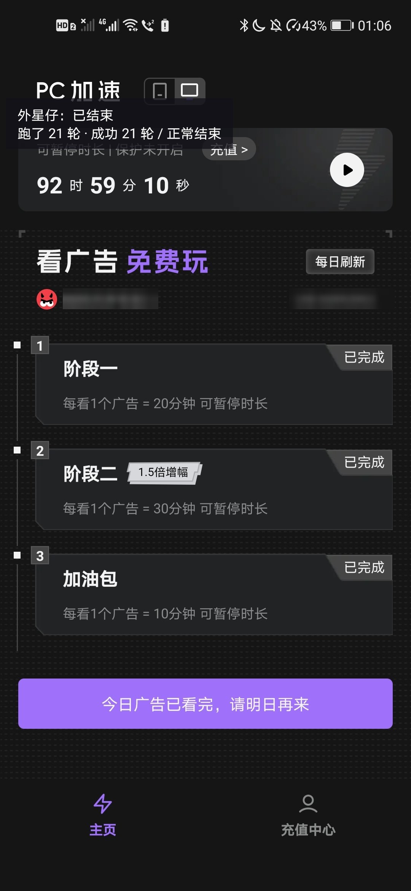

# 外星仔加速器「看广告得时长」自动化

> 我有一台吃灰的安卓手机，和一个每天都要点 21 次「看广告领时长」的习惯。
> 于是我把手机留着插电，让一个自己写的小 App 替我点。

**现在的状态**：连续三天（11-22 / 11-23 / 11-24）全自动跑完 21 条广告、三档全部到手，
我一次都没有在旁边守着。

| | |
|---|---|
| 运行方式 | 手机本地运行，不需要电脑、不需要 root、不需要 Shizuku |
| 我的机器 | 华为 Android 10，1080×2340 |
| 单日耗时 | 首版实测 61.7 分钟；缩短等待后预计 47–50 分钟 |
| 成功率 | 21 / 21（无人值守） |
| 依赖 | 零第三方库，APK 只有 37 KB |



<sub>跑完一天的画面：左上角是我加的悬浮窗，写着「跑了 21 轮 · 成功 21 轮 / 正常结束」；
三档全部「已完成」，按钮变成「今日广告已看完，请明日再来」。昵称和 UID 我打了码。</sub>

> 注：本文由我与 DeepSeek 协作撰写，数据、现象与结论都来自我自己的实测记录。

---

## 一、我是怎么想这件事的

我一开始就没打算做「伪造广告曝光」那种东西——那已经不是自动化，是作弊，
而且真被查到就是一锅端。我要的很简单：

> **广告让它老老实实播完，我只把「伸手点一下」这个动作交给机器。**

这条底线决定了后面所有设计：能不点的绝不点，能少碰的绝不多碰。

## 二、为什么是「无障碍」而不是电脑 + adb

最开始我用的是电脑端 Python + adb：

```bash
uiautomator dump   # 读控件树
input tap x y      # 点坐标
```

能跑，但有两个迈不过去的坎：

1. **电脑得一直连着**。手机放客厅，电脑放书房，中间一根线——这不叫自动化，这叫换个人看着。
2. **读界面很慢**。`uiautomator dump` 在广告页经常卡到超时（十几秒），因为它在等「界面空闲」，
   而视频页永远不会空闲。一条广告光等它就烧掉 20 秒。

后来我想明白：安卓本来就给「辅助功能」留了一条官方通道 —— `AccessibilityService`。
它能做的事，恰好就是我需要的全部：

| 我要做的 | adb 里对应 | 无障碍里对应 |
|---|---|---|
| 看一眼屏幕上有什么 | `uiautomator dump` | 直接拿控件树，**不等空闲** |
| 点一下按钮 | `input tap` | 派发手势 |
| 按返回 / 回桌面 | `input keyevent` | 全局动作 |

于是整个东西就搬进手机里了。电脑只在开发调试时必须，日常运行不需要。

## 三、它到底怎么跑

我不做图像识别，也不做 OCR。外星仔虽然是 Flutter 应用，但它暴露了语义树和自有资源 id
（比如领取按钮是 `com.etalien.booster:id/UIADSubmit`），读控件又快又准。

每一轮就是一个固定的状态机：

```
读首页  →  判定状态  →  点领取  →  等广告起来  →  跟着广告走  →  收场  →  回首页
   ↑                                                                      │
   └─────────────────────────  下一轮（休息 N 秒）  ←──────────────────────┘
```

其中「判定状态」这一步我分成了四种，因为它们的应对完全不同：

| 首页长什么样 | 我怎么做 |
|---|---|
| 按钮写着「看广告 领时长」 | 点它 |
| 按钮写着「广告加载中，请稍等」 | 等，别乱点 |
| 按钮写着「广告加载失败，点击重试」 | 点一次重试 |
| 按钮写着「今日广告已看完，请明日再来」 | 收工，今天到此为止 |

广告落地形态有好几种，我按类型分别收场：

| 广告 | Activity 特征 | 我怎么收场 |
|---|---|---|
| 优量汇视频 | `com.qq.e.ads.PortraitADActivity` | 找关闭控件；100 秒还没走就盲点右上角 X |
| 快手激励视频 | `com.kwad...KsRewardVideoActivity` | 优先点 `close_button` |
| 百度视频 | `com.baidu.mobads...MobRewardVideoActivity` | 45 秒收场（这家的页面全是热点，**不敢点 X**） |
| 章鱼 / sigmob | `com.octopus.*` / `com.sigmob.*` | 超时兜底 |
| 百度百青藤 H5 | `com.byazt.tj.Stub_Standard_...` | 22 秒就放弃——这类页面对无障碍完全不可见，拿不到奖励 |

## 四、我给自己定的三条铁律

这三条都是用掉奖励换来的教训，写在这里也提醒自己别手贱：

**1. 广告页上，除了关闭控件，一个像素都不碰。**
很多 H5 广告整页都是热点，点偏一点就是 deeplink 跳淘宝京东，这一轮的奖励直接作废。

**2. 绝不点「跳过」。**
快手那个控件的 id 叫 `ksad_top_toolbar_close_tip`——名字里有 `close`，但它不是关闭，
是「提前结束」。点下去视频断了，奖励也没了。

**3. 任何手势之前，必须先确认「这是首页」。**
这条是最痛的，见下一节。

## 五、我踩过的四个坑（这部分最值钱）

### 坑 1：下拉刷新把我带进了「充值中心」

有天早上第一次进页面，时长没加载出来，我的代码就去做「下拉刷新」。
结果手势落到了底部导航上，直接进了充值中心，然后卡在那儿出不来。

修法：加了个 `isHomeLike()` 判断——**页面必须带「看广告 / 可暂停时长」或领取按钮，
才允许做任何手势**；否则一律不动，先想办法退回主页。

### 坑 2：我以为外星仔卡死了，其实是自己的连接断了

这是最折磨人的一个。现象是：跑 4–6 条之后，程序报「读不到首页」，
可我盯着手机看——**界面好好的，手点也一点不卡**。

我一开始认定是外星仔卡住，于是花了三四天在「怎么杀掉它」上打转：

- `killBackgroundProcesses` —— 对刚在前台跑过的应用，系统直接忽略
- `FLAG_ACTIVITY_CLEAR_TASK` —— 清不掉正在显示的广告页
- 借「设置 → 应用信息 → 强行停止」—— 打开设置页后我的无障碍根本读不到那个页面，
  反而把设置页盖在最上面，越弄越糟

后来我做了个对照实验，三条证据摆在一起，结论才清晰：

```
我的程序视角：activePkg = 空   homeWindowFound = false   ← 窗口列表是空的
电脑侧视角  ：uiautomator 能读到「70时55分40秒」
人眼视角    ：外星仔能点、不卡
```

**这不是外星仔死了，是我自己的无障碍连接死了。**

真正的解法就一句话：把自己的无障碍开关**关掉再打开**，系统会重新绑定服务。

```java
Settings.Secure.putString(cr, ENABLED_ACCESSIBILITY_SERVICES, "");        // 关
Thread.sleep(900);
Settings.Secure.putString(cr, ENABLED_ACCESSIBILITY_SERVICES, "包名/服务类名"); // 开
```

实测 **1 秒内恢复**，进程不退出、悬浮窗不消失、跑到第几轮也不会丢
（进度存在 SharedPreferences 里，重连后从第 N 轮接着跑）。

> 这一步需要 `WRITE_SECURE_SETTINGS` 权限，得用 adb 授权一次，重启手机也不会丢。
> 没给也能跑，只是连接断掉后不能自愈，会停在那里等人点。

### 坑 3：悬浮窗会莫名消失

悬浮窗不是装饰品——**它是我判断「它到底还活着吗」的唯一依据**。它一消失，我就成了瞎子。

根因很蠢：补挂逻辑依赖无障碍服务实例，而服务被系统解绑后那个实例变成 `null`，
补挂被直接跳过。程序在「没有服务」的状态下继续跑，悬浮窗就永远回不来。

改成三件事之后就再没复现过：
- 补挂用 Application Context，不再依赖服务实例；
- 加看门狗，每秒检查一次，服务实例丢了就重建；
- 窗口 `isAttachedToWindow()` 为假就重新挂上。

### 坑 4：广告 SDK 自己会「累」

连着跑十几条之后，按钮一直显示「广告加载失败」，怎么点都没反应。
网络是好的（ping 20ms），App 也正常。

有次我手动把外星仔从后台划掉再打开，**广告立刻恢复**。
所以这是 SDM 侧状态退化，不是网络问题。

现在的处理是：连续无填充就等 3 分钟重试（最多 3 次），还不行就停手保留进度。
更彻底的做法（用最近任务清理重置外星仔）我还没做，先记在这里。

## 六、怎么用

### 6.1 安装

1. 到 [Releases](https://github.com/labmanH2/waixingzai-ad-auto/releases) 下载最新的 `wzauto.apk`；
2. 手机上允许「安装未知来源应用」；
3. 华为/荣耀会弹「风险提示」→ 点 **继续安装**（覆盖安装要再点一次）。

### 6.2 三个权限

| 权限 | 作用 | 怎么给 |
|---|---|---|
| **无障碍服务** | 读界面、点按钮 | App 里点「① 打开无障碍设置」→ 找到「外星仔自动化」→ 开启 |
| **显示在其他应用上层** | 悬浮窗 | App 里点「③ 悬浮窗权限」→ 允许 |
| **WRITE_SECURE_SETTINGS** | 连接断了能自己重建 | adb 授权一次，**重启不丢** |

```bash
adb shell pm grant com.wz.auto android.permission.WRITE_SECURE_SETTINGS
```

### 6.3 开始跑

1. 打开 App，轮数保持 **21**（正好是每日上限的三档 9 + 3 + 9）；
2. 「轮间休息」按需选，默认 **15 秒**；
3. 点「**② 开始**」；
4. 手机插着电、别锁屏（App 会持有屏幕常亮锁）；
5. 剩下的交给它。

悬浮窗长这样，我只需要看第一行的数字在不在跳：

```
外星仔 #128                    ← 心跳，每秒 +1；停住 = 卡了
第 7/21 轮 · 广告中 42s · VIDEO
成功 6 / 6
```

跑完它会变成结果摘要，不会自己消失：

```
外星仔：已结束
跑了 21 轮 · 成功 21 轮 / 正常结束
```

### 6.4 推送（可选）

主界面「推送设置」里填 Server 酱的 SendKey（[sct.ftqq.com](https://sct.ftqq.com) 获取），
勾上「任务结束时推送」，可以用「测试」先验一条。

推送内容包含：停止原因、跑了几轮、成功几轮、**总用时**、以及最近十几行日志。

> 密钥在界面上默认是圆点显示。**我踩过一次坑**：那张截图里密钥是明文的，
> 等于直接公开了，只能作废重发。别学我。

### 6.5 我建议的运行环境

- 一台闲置手机，插电、连 WiFi、丢一边；
- 把本 App 从电池优化里排除（`设置 → 电池 → 应用启动管理 → 手动管理`）；
- **别关掉外星仔的「自启动」**，否则重新拉起可能失败。

## 七、电脑端脚本（我留下的兜底方案）

`auto.py` 是我最早写的版本，现在留着当备胎——当 App 出问题、或者我想在电脑上看着跑时用它。

```bash
python auto.py probe                                     # 只看余额和阶段，不动手
python auto.py run                                       # dry-run，打印计划
python auto.py run --act --rounds 21 --gap 25 55 --max-minutes 95
```

它有一条 App 没有的优势：`am force-stop` 可以直接杀掉外星仔，
碰到「关不掉的广告页」比 App 利索。插线不方便时也能走无线调试：

```bash
adb tcpip 5555 && adb connect <手机IP>:5555
```

## 八、现在还存在的问题

我不想把它写成「完美方案」。以下是截至 2026-11-24 的真实状况：

| # | 问题 | 影响 | 现状 |
|---|---|---|---|
| 1 | 无障碍连接仍会周期性断开 | 每次损失 10–20 秒 | 已能 1 秒自愈，未根治 |
| 2 | 广告填充随时段波动大 | 凌晨常整段「加载失败」 | 已加等待重试，仍可能空手 |
| 3 | H5 广告拿不到奖励 | 每遇一次损失一轮（约 10%） | 无解，22 秒放弃以省时间 |
| 4 | 广告 SDK 会退化 | 跑十几条后填充骤降 | 需手动杀一次外星仔，自动重置未做 |
| 5 | 华为安装器要手动确认 | 装新版要点一次「继续安装」 | 已脚本化自动点，但非零成本 |
| 6 | 坐标以 1080×2340 为基准 | 异形屏/平板可能偏 | 按分辨率等比缩放，建议先 `probe` 核对 |
| 7 | 没有 `force-stop` 权限 | 卡死的广告页只能靠返回+重连 | 已被「切开关重建」绕开 |

## 九、几个设计取舍（我为什么这么选）

- **不追求「等到账」**：奖励是广告 SDK 异步发的，等不等都会发。
  所以我最多等 7 秒，页面能读就进下一轮，到没到账由下一轮的起始读数对照体现。
- **宁可不动，也不要乱动**：所有手势都有前置条件（必须在首页）；
  凡是可能点到热点的地方一律不点，代价是「救不回来的广告就放弃」。
- **保留电脑版**：App 更省事，但 PC 版在排查问题时更好用（能 `force-stop`、能直接抓 dump）。
  两套并存，互为兜底。

## 十、仓库结构

```
auto.py                 PC 版控制器（adb 驱动）
observe_p0.py           只读观察器：采样界面、导出控件树
android-app/            手机 App 源码（无 Gradle，手工编译）
  src/com/wz/auto/
    AutoService.java    状态机主体：读页面、跟广告、自愈重连
    MainActivity.java   界面：轮数、休息时长、推送设置、权限入口
    Overlay.java        悬浮窗（含脱离重挂）
    Push.java           Server 酱推送（TLS 修复 + 重试）
  build.ps1             aapt2 + javac + d8 + zipalign + apksigner 一键打包
docs/findings-p0.md     早期界面勘察记录
CHANGELOG.md            逐版本记录，含每次实测数据和踩坑过程
```

想自己编译（不需要 Gradle）：

```bash
# 需要 JDK 17 + Android SDK（platforms;android-30 + build-tools;34.0.0）
powershell -ExecutionPolicy Bypass -File android-app/build.ps1
```

---

## 免责声明

- 我这个项目跟外星仔加速器官方没有任何关系，也没获得授权；
- 自动化操作**大概率违反该应用的用户协议**，可能导致账号被限制、时长被清零，风险自负；
- 请别拿它做商业用途或批量操作——那已经不是「个人自动化」，而是广告欺诈了。

代码用 MIT 协议开源，见 [LICENSE](LICENSE)。
